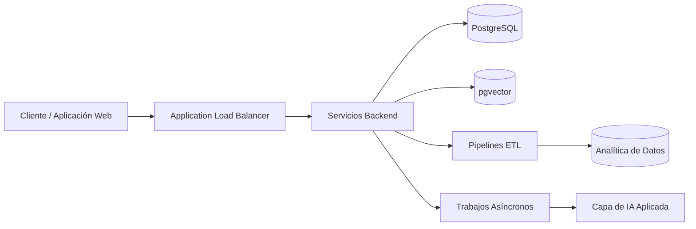

  

<h1 align="center">Software Engineer | Backend, Cloud & IA Aplicada</h1>

  

  
  

  
  
  
  
  
  
  
  

  <i>Sistemas Backend • Arquitectura Cloud • IA Aplicada • Ingeniería de Datos</i>

---

## 🚀 Stack Tecnológico

### 🔹 Backend & Núcleo
* **Lenguajes y Frameworks:** Java, Spring Boot 3, Python, FastAPI
* **Arquitectura:** APIs REST, Arquitectura por capas, DTOs y MapStruct, diseño orientado a servicios

### ☁️ Cloud & DevOps
* **Plataformas Cloud:** AWS (ALB, EC2, RDS, Lambda)
* **Contenedores y Redes:** Docker, Docker Compose, Nginx Reverse Proxy, Aislamiento de redes (Redes Bridge)
* **Entorno:** Linux (WSL2 / Ubuntu)

### 📊 Datos & IA Aplicada
* **Bases de Datos:** PostgreSQL, pgvector (Búsqueda semántica)
* **Ingeniería de Datos:** Pipelines ETL, Scrapy, PySpark, SQLite

---

## 🛠️ Proyectos Destacados

| Proyecto | Stack Tecnológico | Enfoque Arquitectónico Principal |
| :--- | :--- | :--- |
| **[EcoAir Backend](https://github.com/oskar-ortiz/ecoair-docker-backend)** | Java, Docker, NGINX | Aislamiento de contenedores, volúmenes persistentes y diagramas de topología en Mermaid.js |
| **[AWS Cloud Architecture](https://github.com/oskar-ortiz/AWS-Practicas)** | AWS, ALB, RDS, Flask | Networking Cloud Multi-AZ, enrutamiento y patrones de despliegue |
| **[HotelSpringBoot_V1](https://github.com/oskar-ortiz/HotelSpringBoot_V1)** | Java, Spring Boot, MapStruct | Estructura backend limpia por capas, mapeo DTO y separación de servicios |
| **[Laboratorio ETL Scrapy](https://github.com/oskar-ortiz/Laboratorio_ETL_SCRAPY)** | Python, Scrapy | Extracción web automatizada y pipelines de transformación estructurada |
| **[Laboratorio Spark](https://github.com/oskar-ortiz/Laboratorio_Spark)** | Python, PySpark | Procesamiento de datos distribuidos y flujos de trabajo analíticos |

---

### 📈 Resumen de Arquitectura de Sistemas

---

## 👨‍💻 Sobre mí

Soy un Software Engineer enfocado en backend, infraestructura cloud y soluciones de IA aplicada. Me apasiona diseñar sistemas escalables, confiables, observables y orientados a resultados reales de negocio.

Trabajo con una visión práctica y arquitectónica en:
- APIs y servicios backend robustos
- Arquitectura cloud con AWS y contenedores
- Procesamiento de datos y ETL
- Integración de capacidades de IA en productos reales
- Soluciones con enfoque en mantenibilidad, seguridad y desempeño

---

## 📍 Contacto y Portafolio

- **Portafolio:** https://oskar-ortiz.vercel.app
- **LinkedIn:** https://www.linkedin.com/in/oskar-ortiz-4862233b8/
- **Email:** oskarortiz124@gmail.com

  

  Construyendo sistemas escalables, infraestructura moderna y soluciones con IA aplicada.

